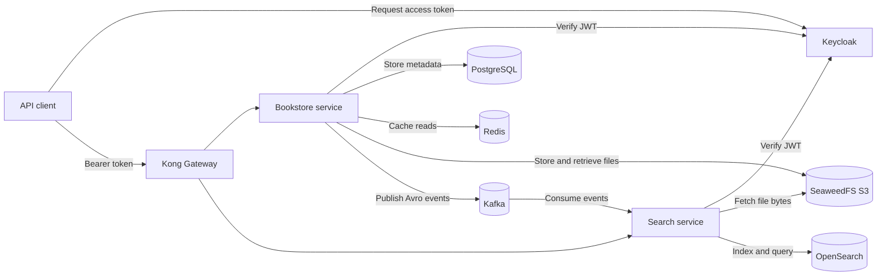
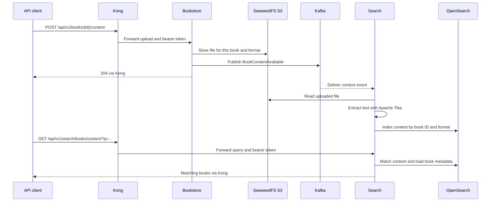

# BookStore

BookStore is a backend demo of domain-driven design (DDD) and hexagonal architecture. Bookstore manages books, authors,
and catalogs, including their relationships and PDF, EPUB, and RTF uploads. Search offers separate queries for book
metadata, extracted document text, and catalogs. A book can have one file per format, and replacing one format preserves
the others.

## System design



| Module                  | Responsibility                                                                                                                                      |
|-------------------------|-----------------------------------------------------------------------------------------------------------------------------------------------------|
| `book-service`          | Owns the book, author, and catalog model. Writes metadata to PostgreSQL, uses Redis for cached reads, and stores uploaded files through the S3 API. |
| `search-service`        | Consumes Kafka events, extracts document text with Apache Tika, and maintains OpenSearch indexes for book metadata, book content, and catalogs.     |
| `event-contracts`       | Shared Avro schemas and generated event classes.                                                                                                    |
| `common-infrastructure` | Shared JWT, rate limiting, Kafka health, Keycloak health, and S3 client and health configuration.                                                   |

The domain defines entities and value objects for books, authors, and catalogs. Application use cases coordinate work
through ports. REST and Kafka listeners are inbound adapters, and jOOQ, Redis, S3, Kafka producers, and OpenSearch
supply outbound adapters. The OpenAPI contracts generate the Java API interfaces and DTOs used at the HTTP boundary.

### Upload to search



Search is eventually consistent. An upload can succeed before its content appears in search. Full-text search of scanned
PDFs requires OCR or an embedded text layer.

### Technology stack

- **Application:** Java 25, Spring Boot 4, Spring Security, Spring Actuator, Resilience4j, Gradle Wrapper.
- **Data:** PostgreSQL, Liquibase, jOOQ, Redis, SeaweedFS (S3 API), OpenSearch.
- **API and messaging:** OpenAPI Generator, Swagger UI, Kafka, Apache Avro, Apache Tika.
- **Local infrastructure and tests:** Docker Compose, Kong Gateway, Keycloak, Paketo Buildpacks, JUnit, Mockito,
  Testcontainers.

## Build and run

Run commands from the repository root. Install a Java 25 JDK, Docker with Compose, `curl`, and `jq`. Use the Gradle
Wrapper in this repository.

### 1. Configure and start infrastructure

Create a root `.env` with the local Kafka and S3 settings before starting the stack.
See [docker/.env-example](docker/.env-example) for the container-specific overrides.

```dotenv
BOOK_TOPIC=bookstore.book-events
CATALOG_TOPIC=bookstore.catalog-events
BOOK_S3_ENDPOINT=http://localhost:8333
BOOK_S3_PATH_STYLE=true
AWS_ACCESS_KEY_ID=book_admin
AWS_SECRET_ACCESS_KEY=book_secret
```

```bash
docker compose up -d --wait postgres redis kafka opensearch seaweedfs keycloak
```

Keycloak imports the [development realm](docker/keycloak/bookstore-realm.json) on first startup. Existing Keycloak
volumes retain their realm configuration. SeaweedFS provisions the `book-store` bucket from its Compose configuration.
If you use a different bucket, create it before starting either app.

Create the book and catalog event topics and their dead-letter topics before starting the apps. Both apps use the same
topic names from `.env`.

```bash
(
  set -e
  book_topic=$(sed -n 's/^BOOK_TOPIC=//p' .env)
  catalog_topic=$(sed -n 's/^CATALOG_TOPIC=//p' .env)
  dlt_suffix=$(sed -n 's/^DLT_PREFIX=//p' .env)
  dlt_suffix=${dlt_suffix:-.DLT}

  for topic in "$book_topic" "$catalog_topic" "$book_topic$dlt_suffix" "$catalog_topic$dlt_suffix"; do
    docker compose exec -T kafka /opt/kafka/bin/kafka-topics.sh \
      --bootstrap-server kafka:19092 --create --if-not-exists \
      --topic "$topic" --partitions 1 --replication-factor 1
  done
)
```

### 2. Generate sources

Bookstore runs Liquibase migrations automatically at startup. The jOOQ generator reads the existing PostgreSQL schema,
so point it at a database where those migrations have already run.

Generate jOOQ, OpenAPI, and Avro sources:

```bash
(
  set -a
  . ./.env
  set +a
  ./gradlew :book-service:jooqCodegen
)
./gradlew :book-service:openApiGenerate :search-service:openApiGenerate :event-contracts:generateAvro
```

| Generator         | Input                                          | Output                                          |
|-------------------|------------------------------------------------|-------------------------------------------------|
| jOOQ              | Migrated PostgreSQL `public` schema            | `book-service/build/generated-src/jooq/main`    |
| OpenAPI Generator | Each service's `src/main/openapi/openapi.yaml` | Each service's `build/generated-src/openapi`    |
| Avro              | `event-contracts/src/main/avro`                | `event-contracts/build/generated-src/avro/main` |

OpenAPI and Avro generation are wired into compilation. Run jOOQ generation explicitly on a fresh checkout, after a
schema change, or after cleaning the build output.

### 3. Run tests and build

Keep Docker running for Testcontainers integration tests.

```bash
./gradlew test
./gradlew build
```

**Use `./gradlew test` for the normal test run. Avoid `./gradlew clean test`.** The `clean` task deletes generated
sources from `build/`, including jOOQ sources that compilation does not regenerate. If you need a clean build, run
`clean`, then the generation commands above, then `test` or `build`.

### 4. Run the apps locally

Start each app in a separate terminal. The defaults give each service its own ports and Keycloak audience. Supply any
local overrides, including S3 credentials for content operations, through your shell or IDE run configuration.

```bash
# Terminal 1: Bookstore API on 8080, management on 8001
./gradlew :book-service:bootRun
```

```bash
# Terminal 2: Search API on 8082, management on 8002
./gradlew :search-service:bootRun
```

For this mode, call the app ports directly. The checked-in Kong routes target the Docker app containers described below.

### 5. Run the apps in Docker with Kong

After generating sources, build the images locally with Paketo Buildpacks:

```bash
./gradlew bootBuildImage
```

Runtime settings come from `.env` and [docker/.env-example](docker/.env-example). The second file overrides host
addresses with Docker service names. Keycloak still issues tokens with the public issuer on port 8081, and the app
containers use the Docker network to fetch keys and discovery metadata.

```bash
docker run -d --name bookstore-book-service \
  --network bookstore_default --memory 2g \
  --env-file .env --env-file docker/.env-example \
  -e KEYCLOAK_AUDIENCE=book-service \
  -p 127.0.0.1:8001:8001 \
  abondar/bookstore-book-service:0.0.1

docker run -d --name bookstore-search-service \
  --network bookstore_default --memory 2g \
  --env-file .env --env-file docker/.env-example \
  -e KEYCLOAK_AUDIENCE=book-search \
  -p 127.0.0.1:8082:8080 -p 127.0.0.1:8002:8001 \
  abondar/bookstore-search-service:0.0.1

docker compose up -d kong
```

Both containers listen on port 8080 inside Docker. Kong uses their container names and probes `/readyz` on that port.
The loopback mappings provide direct management access on 8001 and 8002 and private Search index administration on 8082.

| Entry point                          | URL                                                                                                 |
|--------------------------------------|-----------------------------------------------------------------------------------------------------|
| Public API through Kong              | `http://localhost:8000/api/v1/…`                                                                    |
| Bookstore Swagger UI through Kong    | [book-service-doc.localhost:8000](http://book-service-doc.localhost:8000/swagger-ui/index.html)     |
| Search Swagger UI through Kong       | [search-service-doc.localhost:8000](http://search-service-doc.localhost:8000/swagger-ui/index.html) |
| Kong readiness                       | `http://localhost:8100/status/ready`                                                                |
| Bookstore and Search Actuator health | `http://localhost:8001/actuator/health`, `http://localhost:8002/actuator/health`                    |
| Private Search index management      | `http://localhost:8082/internal/api/v1/indexes`                                                     |
| Keycloak development console         | `http://localhost:8081/admin`                                                                       |

### 6. Create Search indexes after startup

Once Search is running, create its indexes through the private endpoint before sending Bookstore writes that produce
indexing events. The request requires a Search admin token.

```bash
ADMIN_TOKEN=$(curl -fsS --user 'book-search-admin:book-search-admin-dev-secret' \
  --data 'grant_type=client_credentials' \
  http://localhost:8081/realms/bookstore/protocol/openid-connect/token | jq -er '.access_token')

curl -fsS -w 'HTTP %{http_code}\n' -X POST \
  -H "Authorization: Bearer $ADMIN_TOKEN" \
  http://localhost:8082/internal/api/v1/indexes
```

Expect `HTTP 201`. Index creation preserves existing indexes.

### 7. Run end-to-end tests

With both containers and Kong running, source the helper from the repository root:

```bash
source ./e2e-setup.sh
```

The script checks Kong and Search readiness and sets the URLs and Keycloak tokens in your shell. Follow [e2e.md](e2e.md)
for the curl scenarios, fixtures, and recorded results.
